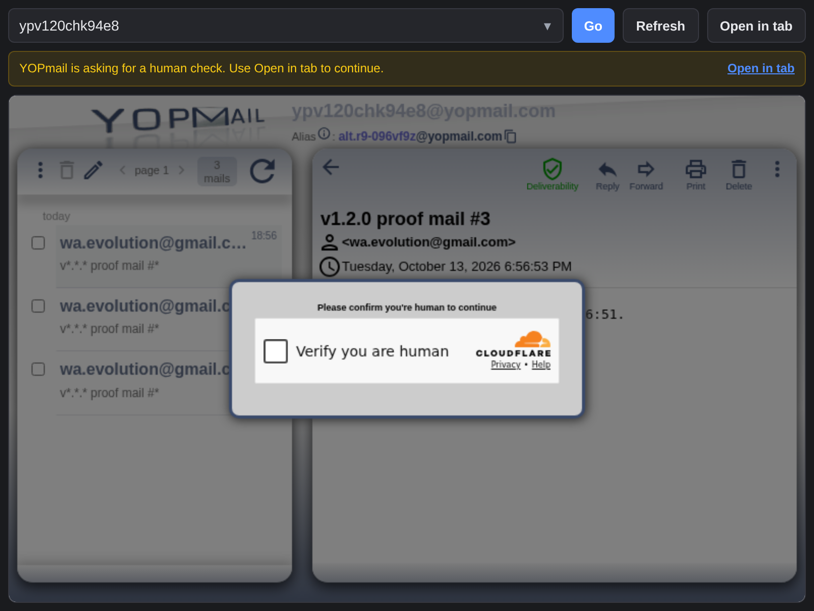
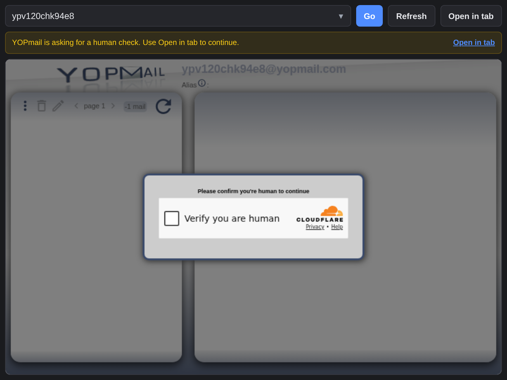
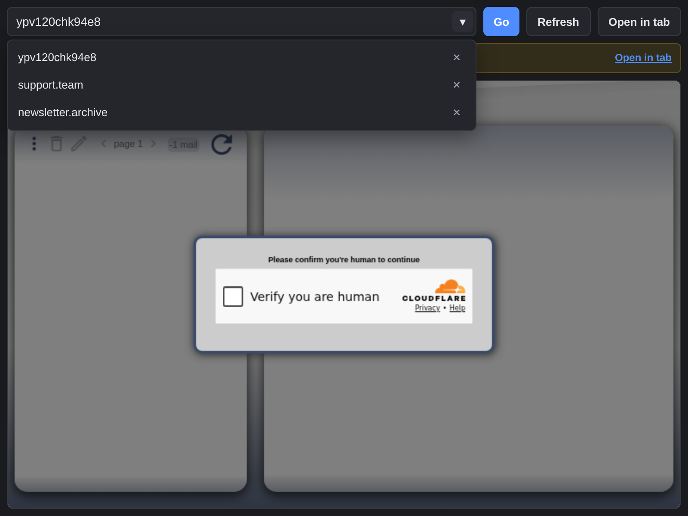

# YOPmail Checker

A dependency-free Manifest V3 Chrome extension that embeds the **real YOPmail webmail**
inside the toolbar popup. Type an address, read the inbox, and open it in a tab when you
need the full site — no API scraping, no third-party service.

Current version: **1.2.1**

## Screenshots

**Inbox** — YOPmail's webmail embedded under the address bar.



**Human check** — YOPmail's Turnstile challenge is rendered *inside* the popup. YOPmail's
own `window.top.showRc()` call fails across the extension/frame boundary, so the extension
forwards it to the same-origin webmail frame.



**Saved addresses** — switch between recently used inboxes from the dropdown.



## Install

### From the zip

1. Download `yopmail-checker.zip` and unzip it.
2. Open `chrome://extensions` and enable **Developer mode**.
3. Click **Load unpacked** and select the unzipped folder.

### From source

1. Open Chrome and go to `chrome://extensions`.
2. Enable **Developer mode** (toggle in the top-right corner).
3. Click **Load unpacked**.
4. Select this folder (the one containing `manifest.json`).

The YOPmail Checker icon appears in your toolbar.

## Use

1. Click the extension icon.
2. Enter a YOPmail address (`hermes.test.e091mc` or `hermes.test.e091mc@yopmail.com`).
3. Click **Go** to load the inbox inside the popup.
4. Click **Refresh** to reload the embedded page.
5. Click **Open in tab** to open the same inbox in a real Chrome tab.

### Saved addresses

- The last used address is stored under `yopmail_address` and restored when the popup opens.
- Every address you check is added to `yopmail_addresses` (newest first, capped at 25).
- Click the **▾** toggle to open the saved-addresses dropdown.
- Pick a row to load that inbox immediately.
- Click the **✕** on a row to remove that address from history.
- Upgrading from an older single-address version migrates that value into the history list.

## How it works

### Framing

YOPmail sends `X-Frame-Options: sameorigin`, so it cannot be embedded as-is. A static
Declarative Net Request ruleset (`rules.json`) removes the framing/CSP response headers
from YOPmail sub-frames, which lets the webmail load inside the popup.

### Session priming

YOPmail needs a session cookie that its own JS cannot write inside the embedded
(third-party) frame, so the mailbox can come back empty while the page itself renders.
Before every iframe load the popup primes the session: it fetches
`https://yopmail.com/en/?login=<login>` with credentials and writes the `ytime` cookie
(`HH:MM`, local time) through the `chrome.cookies` API. This runs on popup open with a
saved address, **Go**, **Refresh** and selecting a saved address.

If the embedded inbox still comes back with no message rows (and no human-check state),
the content script reports it and the popup retries once with a fresh prime — at most two
extra attempts. After that it shows *"Mailbox looks empty — press Refresh, or use Open in
tab."* and stops (no infinite reload loop).

### Human check

YOPmail occasionally asks for a human verification before showing the inbox list. Two
details make this work inside a popup:

- YOPmail's `/inbox` page runs `window.top.showRc()` when a challenge is served. Inside
  the popup `window.top` is the extension page (cross-origin), so that call throws and the
  widget never appears. The extension forwards the request to the same-origin webmail
  frame, so the Turnstile widget is rendered **inside the popup iframe**.
- A hint bar with **Open in tab** appears while the challenge is displayed and clears once
  it is solved.

The hint is shown only when the challenge is **actually displayed** — YOPmail keeps the
challenge container (`#r_parent`) in the page even when no challenge is running (then it
is `display: none`), so a healthy mailbox never shows the wall hint.

When the challenge is solved, the extension persists the YOPmail session cookies (30-day
expiry, HttpOnly included) through the `chrome.cookies` API, so the session survives a
browser restart.

### Rate limiting

If YOPmail rate-limits the IP (HTTP 429), the popup says so —
*"YOPmail is rate-limiting requests — wait a minute and press Refresh."* — and does not
retry in a loop.

Always use **Open in tab** if the embedded view does not load correctly.

## Privacy

- No analytics, no remote code, no third-party server.
- State lives in `chrome.storage.local` (`yopmail_address`, `yopmail_addresses`).
- Network requests go only to `yopmail.com` (and Cloudflare's Turnstile endpoints when a
  challenge is served).

## Files

- `manifest.json` — MV3 manifest.
- `rules.json` — DNR rules that remove framing/CSP headers from YOPmail responses.
- `popup.html`, `popup.css`, `popup.js` — popup UI and logic.
- `background.js` — service worker; persists session cookies after a human check.
- `content-script.js` — MAIN-world script that renders the human check inside the frame.
- `content-script-isolated.js` — isolated-world detector for the wall and the empty list.
- `docs/screenshots/` — screenshots used in this README (not shipped in the zip).
- `icon16.png`, `icon48.png`, `icon128.png` — extension icons.
- `notes/` — coordination briefs (not shipped in the zip).

## Testing / dev

The popup supports a `?address=` query parameter for headless testing and automation:

```bash
chromium --headless=new --load-extension=/path/to/yopmail-chrome-ext \
  --user-data-dir=/tmp/yp-profile --dump-dom \
  "chrome-extension://<extension-id>/popup.html?address=hermes.test.e091mc@yopmail.com"
```

When `?address=` is present, the popup prefills and saves that address and immediately
loads the inbox without requiring a click.

## Zip

`yopmail-checker.zip` is a packaged copy of the extension for easy sharing. It excludes
`notes/`, `docs/`, `node_modules/`, the screenshots, and the zip itself.
